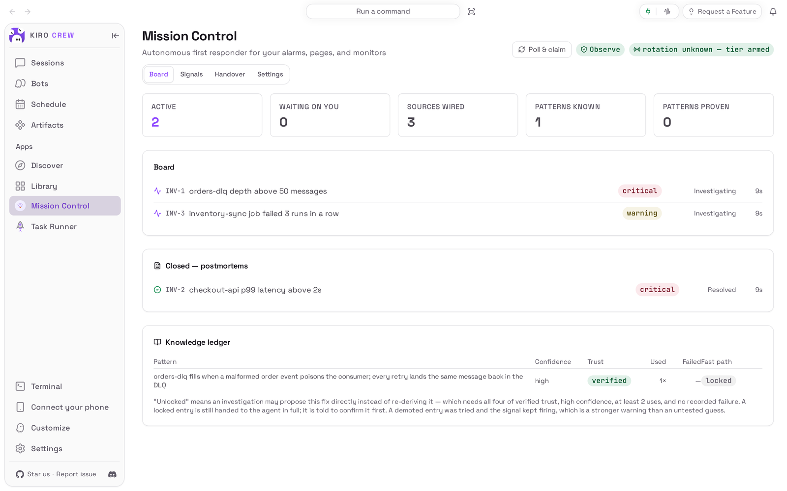
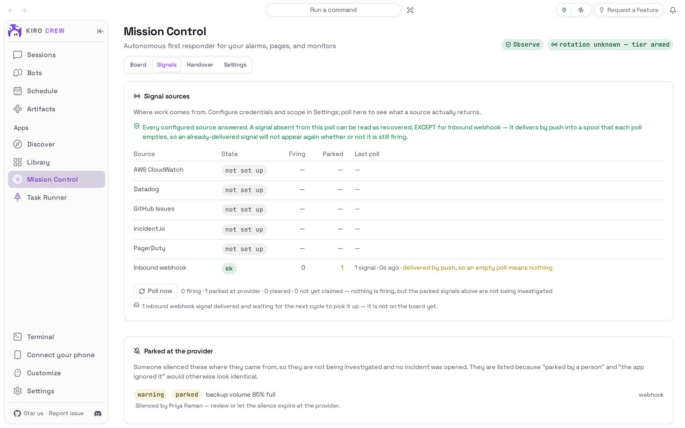
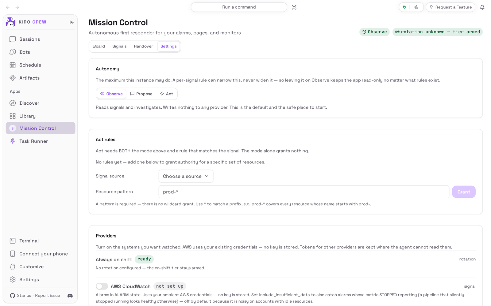

# Ops Mission Control

<picture>
  <source media="(prefers-color-scheme: dark)" srcset="docs/media/hero-dark.png">
  
</picture>

**Your alarms claimed, investigated and remembered, before anyone has to look.**

Ops Mission Control is an app for [Kiro Crew](https://github.com/kirodotdev/KiroCrew),
the open-source personal AI agent.

## What it is

Once it is on, **Mission Control** appears under **Apps** in the sidebar. It
watches the alarm and paging systems you connect, claims each alarm that fires,
and starts an agent investigating it in a chat you can read and answer from the
incident itself. Every fix your team confirms goes into a knowledge ledger, so
the next time the same failure fires, the investigation starts from that fix.
It is read-only until you decide otherwise.

**Get started:** open **Apps → Library**, choose **Show N disabled apps**, and
on the **Ops Mission Control** tile open the **⋯** menu and choose **Enable**
(see [Install](#install)).

## The problem it solves

An alarm fires at 3 am and somebody has to wake up, work out which system it is,
find the runbook, and rediscover a fix the team already found last month. Most
of that work is the same every time. Ops Mission Control does the first pass for
you: it picks the alarm up, gathers the context, tells the investigating agent
what worked before, and keeps a plain record of what it found, so the person who
does look starts from an answer instead of a blank screen.

It does not change anything in your systems on its own. Out of the box it only
reads and investigates; acknowledging, commenting, silencing or resolving an
alarm is something you switch on yourself, per kind of alarm.

## Top 3 use cases

### 1. A repeat failure starts from the fix you already learned

The orders dead-letter queue is filling up again. You open the incident on the
**Board** and, before reading a single log, you see the pattern your team
recorded the last time and its fix: read the head message, move it to the
quarantine queue, redrive the rest. The board also says how far to trust it
(verified, high confidence, used once), and that the agent must confirm it
before proposing it.


### 2. Ask the investigation what it thinks, right from the incident

Each incident has its own investigation chat, shown under it on the board. You
type a question there, such as "is this the poison-message problem we saw
before, and what would you do?", and the agent answers in place. Here it lists
the steps it would take, and says that because the app is in **Observe** it will
only propose them: you make the move.


### 3. Tell "everything is quiet" apart from "someone silenced it"

The **Signals** tab shows what each source actually returned on its last check,
not just whether it is set up. Choose **Poll now** and every connected source is
asked again. An alarm that a person silenced at its source is listed under
**Parked at the provider**, with who silenced it, so a quiet board never hides a
muted problem.



## Watch it


[Watch the walkthrough as a video (MP4)](docs/media/walkthrough.mp4).

<sub>Recorded from a real Kiro Crew (55439d8770, with its built-in copy of this app
removed so this repository's copy could be installed) on a throwaway home with
made-up demo data: the company, its services, the alarms and the person who
silenced one are invented, and the alarms arrived through the app's own signed
webhook. The agent's answer came from a live AI model, so its wording differs
from run to run. The wait for the answer is shortened. After the agent answers
without recording a diagnosis, the app moves the incident to **Waiting on you**
(shown as "Stopped, no diagnosis" on the **Handover** tab at the end), which is
what it does for any investigation that stops short of a conclusion.</sub>

## Install

**Today: Ops Mission Control comes with Kiro Crew.** Nothing needs downloading.
It starts switched off:

1. In Kiro Crew, open **Apps → Library** in the left sidebar.
2. Choose **Show N disabled apps** (N is how many apps are switched off).
3. On the **Ops Mission Control** tile, open the **⋯** menu and choose **Enable**.
4. **Mission Control** now appears under **Apps** in the sidebar.

**Coming soon: from the Kiro Crew App Store.** Once this app is listed there:

1. Open **Apps → Discover** in the left sidebar.
2. Search for **Ops Mission Control** and choose **Install**.
3. Kiro Crew asks **Trust “Ops Mission Control” to run its own code?** The app
   runs its own code inside Kiro Crew to poll your alarm systems, keep its
   incident record and ledger, and talk to the providers you connect. Trusting
   it gives that code the same access Kiro Crew has (your files, your saved
   sign-ins and the internet), as the dialog says. If you are happy with that,
   choose **Trust this app**. You can take it back later in **Settings →
   Security → Third-party apps**.
4. The app installs switched off. Choose **Enable** on its page.

What you need: Kiro Crew on a Mac, Linux or Windows computer, and Kiro Crew must
already be able to chat (if ordinary chats work, investigations work). Then at
least one source of alarms: AWS CloudWatch uses the AWS sign-in already on your
computer; PagerDuty, Datadog and incident.io need a token from that service;
GitHub Issues uses your signed-in `gh`; any other system can send alarms to the
app's signed webhook.

## First run

The board is empty and says **No incidents claimed** and **Connect a provider in
Settings to start watching.** Open the **Settings** tab, find your alarm system
under **Providers**, switch it on and fill in what it asks for. A token you type
is saved where the agent cannot read it, and it is never shown again: the page
only says whether one is set. Then go back to **Board** and choose **Poll & claim**
to fetch what is firing right now.



## How to use it

1. Leave the app on. Every few minutes it checks the on-call rotation and, while
   you are on shift, claims new alarms and starts an investigation for each one.
   **Poll & claim** on the **Board** does the same at once.
2. On the **Board**, select an incident to open it: its source, the known
   patterns it matched and their fixes, the diagnosis once there is one, and its
   investigation chat. Type in the chat to answer the agent or steer it.
3. **Waiting on you** counts incidents where the agent is blocked on you: an
   approval, a question, or an investigation that stopped without a diagnosis.
4. Use **Mark resolved** when you have fixed something yourself. A closed incident
   moves to **Closed — postmortems**, with its write-up.
5. At the end of a shift, open **Handover**: it says what is waiting on a person,
   what is in progress, what keeps happening and which sources are blind spots.
   **Copy as text** gives you the same digest to paste anywhere.
6. When you trust the app with more, change **Autonomy** in **Settings** from
   **Observe** to **Propose** (it drafts the action and asks you first) or **Act**
   (it does it, but only for alarms that match an **Act rule** you add with
   **Grant**). Every action is recorded.


Also in **Settings**: **Mirror incidents to Slack** posts the board to a channel
through the Slack connection Kiro Crew already has; **Notify me on state changes**
shows desktop notifications; **Share the knowledge ledger with my team** keeps the
ledger in a git repository you choose; **Only the on-call instance picks up work**
is for teams running several copies.

## Settings & data

- **Where your data lives:** incidents, the knowledge ledger and the app's
  settings are in `~/.kiro/crew/apps/ops-mission-control/data/` (under
  `$KIROCREW_HOME` if you set it). Provider tokens are in
  `~/.kiro/crew/ops_mission_control_secrets.json` and the autonomy settings in
  `~/.kiro/crew/ops_mission_control_policy.json`, files the agent can never
  change and, for the tokens, never read.
- **What leaves your computer:** the app talks to the alarm services you connect,
  with your tokens. The alarm text and what the agent finds go to the same AI
  model as the rest of your Kiro Crew; tokens and other credentials are removed
  from that text first. With Slack on, incident summaries go to your channel;
  with ledger sharing on, the ledger goes to the repository you named.
- **What it never does on its own:** in **Observe** (the default) it writes
  nothing to any provider. A silence it sets always expires (4 hours by default,
  never more than 24).
- **Who can change it:** only the person who set up this Kiro Crew can change its
  settings or tokens.
- **Turn it off:** **Apps → Library**, open the **⋯** menu on Ops Mission Control,
  choose **Disable**. Your data is kept.
- **Remove it** (once it is installed from the App Store): the same menu,
  **Uninstall**. **Keep app data** is ticked by default; untick it to delete the
  data too. Provider tokens are kept either way: use **Revoke stored credentials** in **Settings**
  first if you want a token gone. The copy that comes with Kiro Crew can be
  switched off but not removed.

## Troubleshooting / FAQ

**The board says nothing is firing, but I know an alarm is on.**
Open **Signals** and choose **Poll now**. A source shown as **failed** or **not
polled yet** has not been read, which is not the same as quiet. An alarm someone
silenced at the source is listed under **Parked at the provider** and is not
picked up.

**An incident's chat says "Couldn't load this session's messages".**
The investigation for it has not started yet. It starts with the next claim
cycle while you are on shift; **Poll & claim** starts one now.

**Settings answers "owner authorization required".**
Only the person who set up this Kiro Crew can change providers, tokens and
autonomy. Sign in as that person.

**A part of the page says the host does not support it ("host_unsupported").**
Your Kiro Crew is missing something this version of the app needs. Update Kiro
Crew to the latest release.

**I switched to Act and nothing happens.**
**Act** needs both the mode and an **Act rule** that matches the alarm's source
and resource. Add one under **Act rules** with **Grant**.

## Development

This repository is the externally packaged form of the `ops-mission-control`
app that ships built into Kiro Crew. The two share a name, a version and the
same permissions, so the Kiro Crew release that adds built-in adoption can move
an existing built-in install onto this source in place, at a pinned commit.
Until a user's Kiro Crew does that, it keeps running its built-in copy, and
nothing here changes what they run. [PORTING.md](PORTING.md) lists every place
this copy differs from the built-in, every gateway function it still reaches
without an App Kit seam, and every remaining gap.

| Path | What it is |
|---|---|
| `app.json` | The manifest: crons, notification channels, permissions, the `ui` entry and the `l10n` listing copy |
| `backend/routes.py` | The `backend.hooks.routes` entry: the route table and the composition root of the HTTP surface |
| `backend/_host.py` | Everything the backend takes from the gateway: the App Kit seams, and the pinned table of gateway functions with no seam yet |
| `backend/http_routes/` | The handler bodies, one module per slice |
| `backend/models.py`, `store.py`, `ledger.py`, `dispatch.py`, `rotation.py`, `handover.py` | Signals and incidents, the claim index, the knowledge ledger, the claim cycle, autonomy and rotation, the shift digest |
| `backend/providers/` | CloudWatch, PagerDuty, incident.io, Datadog, GitHub Issues, the signed webhook, the schedule file |
| `skills/ops-mission-control/` | The agent skill and its six SOPs, which the crons and investigations follow |
| `ui/src/` | The dashboard page (React), built against `@kirocrew/app-sdk` |
| `ui/i18n/` | The page's strings in every language the dashboard ships |
| `ui/dist/index.mjs` | The built page, **committed**: an install is a plain clone with no build step |
| `ui/tests/`, `ui/e2e/` | UI tests (vitest + jsdom) and a browser check against a live gateway |
| `assets/` | Store icon, hero art and screenshot |
| `tests/` | Backend, skill and manifest tests, runnable offline with pytest |
| `docs/spec.md` | The design record carried over from Kiro Crew |
| `capture/` | Captures the README media from a real, isolated Kiro Crew ([capture/README.md](capture/README.md)) |

### What it needs from Kiro Crew

Kiro Crew 0.13.0 or later (`minKiroCrewVersion`), for App Kit level 1: route
records the app defines itself, the owner gate (`ctx.require_owner`), the shared
embedder (`ctx.embed`) and the seam level (`ctx.sdk_level`), plus the level-0
audit and scrub seams. No backend module imports `kiro_crew`. The gateway
functions with no seam yet (the keystone token store, the sandbox for `git` and
`gh`, the credential check before a ledger push, webhook governance, companion
admission, the shared vector store) are resolved by name in `backend/_host.py`,
each with a stand-in that refuses; a route that needs a missing one answers 503
`host_unsupported`, and the app reports degraded health.

### Provider companions

Bespoke adapters live in a separate Python package installed alongside Kiro
Crew, registered under the `kirocrew.ops_providers` entry-point group:

```toml
[project.entry-points."kirocrew.ops_providers"]
my-company = "my_pkg.ops:register_adapters"
```

```python
def register_adapters(registry) -> None:
    registry.register_signal_source(MyTicketSource())
    registry.register_action_sink(MyTicketSink())
```

An adapter implements one or more of four Protocols in
`backend/providers/base.py`: `SignalSource`, `RotationSource`, `ActionSink` and
`EvidenceSource`. Registration is add-only, and every package passes Kiro Crew's
admission policy before its code is imported.

### Install from a clone

```bash
git clone https://github.com/KiroCrewCaptain/kirocrew-app-ops-mission-control
kirocrew app install ./kirocrew-app-ops-mission-control
```

Then turn it on from **Apps → Library**. The app runs its own code
(`backend.hooks` in `app.json`), so Kiro Crew will not enable it until you trust
it: the Library's **Enable** opens the trust dialog, and **Trust this app and
enable** does both. Until it is trusted, `kirocrew app enable ops-mission-control`
is refused with `app_execution_denied`. While your Kiro Crew still has the
built-in copy installed, the install itself is refused as already installed.
`kirocrew app disable ops-mission-control` turns it off;
`kirocrew app uninstall ops-mission-control` keeps the data and adding
`--purge-data` deletes it.

### Tests

```bash
python -m pip install -r tests/requirements.txt
python -m pytest
cd ui && npm ci && npm run typecheck && npm test && npm run build
```

Kiro Crew itself, at one pinned public commit, is a test dependency: the suite
runs the app against the real sandbox, token store, cron service and
notification bus. `npm run build` must leave `ui/dist/` unchanged; CI checks it.

### Re-capture the README media

The pictures and the recording come from a real, isolated Kiro Crew gateway
driven by [`capture/`](capture/README.md). After any change to what the app shows:

```bash
python capture/capture.py --kirocrew /path/to/KiroCrew
python capture/check_readme.py
```

Then look at every image and at a few frames of the video before committing
(see [CHECKLIST.md](CHECKLIST.md)).

## License

Apache License 2.0. See [LICENSE](LICENSE) and [NOTICE](NOTICE).
